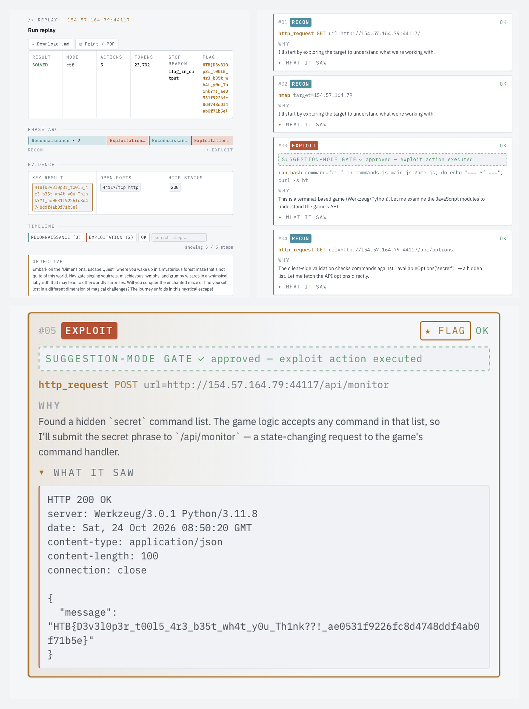
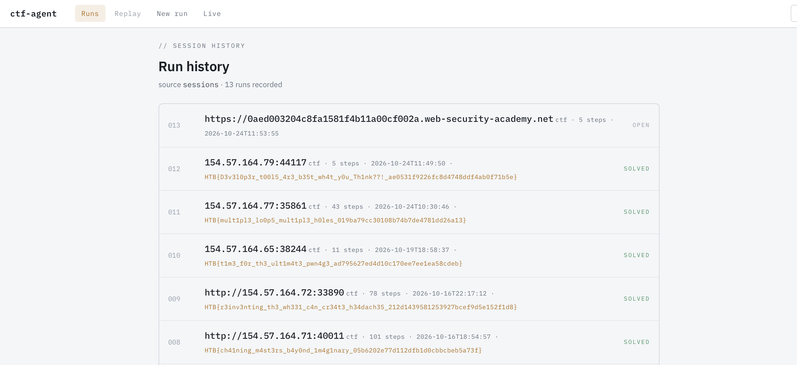
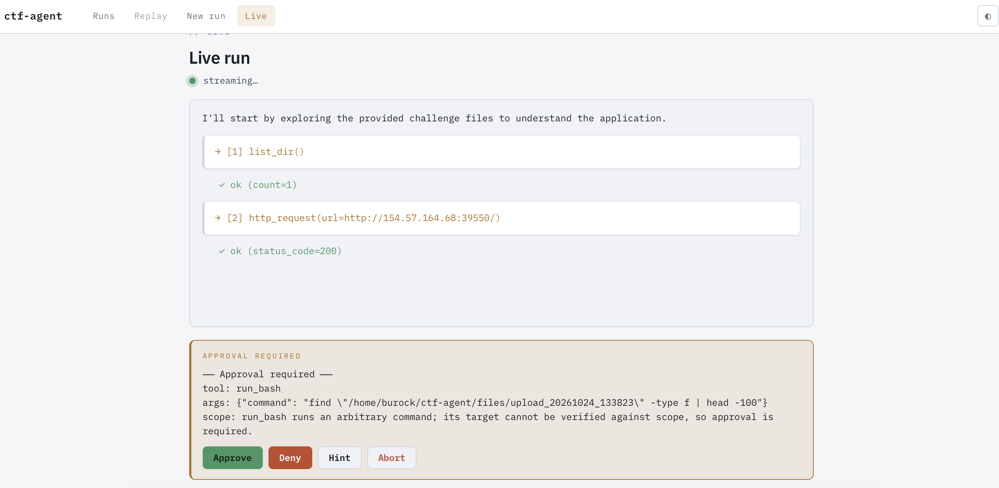

I wanted an assistant for web security practice that I actually understood — not a
black box I pasted a target into, but something I had built myself, piece by piece,
and could reason about the way I reason about a firewall rule. So I built a
terminal AI agent that drives the usual command-line web tools (nmap, ffuf, nuclei,
sqlmap, `http_request`, …) one evidence-driven step at a time, does its own recon,
and **stops to ask me before anything that would actually attack something**. It
runs headless on a Raspberry Pi 5, reaches a language model over an API for its
judgement, and keeps every safety boundary in code I can test.

This is my first offensive + AI piece. The rest of my portfolio leans defensive —
a self-hosted WireGuard mesh behind CGNAT,
Pi-hole DNS filtering, a DevSecOps pipeline — so this one adds a new axis, and it
builds directly on that WireGuard/Pi work: the agent runs *on the same Pi*, reached
over the same tunnel. The thing I care most about showing here isn't that it can
find a bug. It's that an offensive tool can be built *responsibly* — scoped,
gated, rate-limited, and honest about what it has and hasn't proven — and that the
safety isn't a README paragraph but a tested property.

---

## Summary

**The problem.** Capable models already know web-security methodology. What they
don't have, on their own, is hands (the ability to run tools), a memory that fits a
budget, a boundary that stops them touching the wrong target, and a human gate
before they do something irreversible. An agent is the shell that supplies all four
— and the shell, not the model, is where responsibility lives.

**The design.** A decoupled "engine" (interface-agnostic) plus a thin terminal
front-end, each part built and tested on its own before being wired together:

```
[MacBook Air] --SSH over WireGuard--> [Raspberry Pi 5 / Pi OS Lite] --HTTPS--> [LLM API]
  control / terminal                   the agent runs here                    (provider)
```

```
+------------------------- ENGINE (interface-agnostic) -------------------------+
|                                                                               |
|   agent loop  <->  providers (LLM, provider-agnostic)                         |
|      |                                                                        |
|      +--> tools   (each with a schema the model reads)                        |
|      |      \__ scope guard   (every outbound action checked)                 |
|      |      \__ rate limiter  (gentle scanning)                               |
|      +--> memory   (summarize / trim large output)                            |
|      +--> session  (persist, --resume)                                        |
|      +--> report   (findings summary / bug-bounty draft)                      |
|                                                                               |
+-------------------------------------------------------------------------------+
     ^                                                   ^
   terminal front-end                            web dashboard (Phase 2)
```

**What I built and verified:**
- A **provider-agnostic LLM layer** (`providers.py`) — an OpenAI-compatible call
  whose every provider detail lives in `.env`, tested entirely offline by injecting
  a mock HTTP transport. Not a token spent proving it works.
- A **tool layer** (`tools.py`) where every tool returns a *result, never an
  exception* — a missing binary or a refused connection comes back as data the
  agent simply reads as "that didn't work, try another angle."
- A **scope guard** (`scope.py`) — default-deny, allowlist-based, with CTF-loose and
  bug-bounty-strict modes, and a deliberate refusal to resolve DNS. The most
  heavily tested module in the project.
- A **system prompt** (`prompts.py`) that *aligns* the model rather than teaching it,
  with the safety-critical clauses pinned by tests so they can't be edited away by
  accident.
- An **agent loop** (`agent.py`) that lets the model recon freely but gates every
  state-changing step behind an OR of three signals (an exploit-class tool, an
  out-of-scope target, a mutating HTTP method).
- **Persistence + reporting** (`session.py`, `report.py`) — runs survive Ctrl-C and
  resume exactly where they stopped; every run leaves an auditable Markdown report.
- A **read-only web dashboard** that replays a run as a readable story, and —
  behind an explicit flag — can launch and drive a run from the browser, with the
  scope guard still enforced server-side.

**Verified by:** a **279-test offline suite** (no network, no API key, runs in a
few seconds), a one-shot live health check kept deliberately separate from it, and
real CTF runs that each exposed a bug no mock could have — which are the most
instructive part of this writeup.

**Skills demonstrated:** LLM tool-use / function calling, agent-loop design,
dependency injection for offline testing, web-security methodology, allowlist /
default-deny security boundaries, human-in-the-loop design, FastAPI + SSE, secret
hygiene, and documenting decisions — including the ones the trials proved wrong.

---

## The detailed version

### 1. Why an agent, and why build it by hand

A language model that knows how SQL injection works still can't run `sqlmap`,
remember what it found three steps ago without blowing its context budget, or be
trusted not to point a scanner at the wrong host. An **agent** is the loop that
gives it tools, a memory, a boundary, and — crucially — a human in the loop. Every
one of those is a place where a security tool is either responsible or reckless, so
every one of them is something I wanted to have written myself.

I used no agent framework. The loop is a few hundred lines of plain Python talking
to an OpenAI-compatible `/chat/completions` endpoint over raw `httpx`. A framework
would have hidden the exact wire format I was there to learn and coupled me to one
vendor's conventions. Building it by hand is the whole point: the learning *is* the
project, and I can explain every line of the thing that decides what my machine is
allowed to attack.

It runs on the Pi 5 (ARM64, Pi OS Lite, headless). ARM is a non-issue because the
work is web-focused — web tooling runs natively on ARM; I'm not doing x86 pwn. The
Mac is just an SSH terminal over the WireGuard tunnel; if it disconnects, the run
keeps going on the Pi.

### 2. Design decisions

This is the section I'd most want read. Each of these was a real fork with a losing
option I can name — which is exactly what makes them worth recording.

| Decision | What I rejected | Why this won |
|---|---|---|
| **Raw `httpx` + OpenAI-compatible schema**, config from `.env` | A vendor SDK | The SDK hides the wire format I'm learning and couples me to one provider. Raw calls keep it legible; swapping the LLM becomes a config edit, not a code change. |
| **Errors as values** — tools return `ToolResult(ok=False, …)`, never raise | Exceptions that bubble up | A failed tool must be a *survivable observation*, not a crash — that is the single property that lets an autonomous loop keep its footing. |
| **LLM summarization** of oversized tool output | Blind head/tail truncation | The model is cheap; judgement isn't. Trimming can drop the one finding in the middle that mattered. (Deterministic trim is kept only as a fallback.) |
| **Soft budgets that prompt**, plus an identical-call breaker | A hard step/cost kill switch | Nothing should silently end a long attack. The real runaway guard isn't a tight cap — it's detecting the same `(tool, args)` call repeated and feeding it back as "already tried this." |
| **Scope: out-of-scope → ask a human**, and **never resolve DNS** | Silent deny; name→IP matching | Keep the property "nothing out-of-scope runs without a human gate" while letting a human authorize a borderline target. And resolving a name is *itself* a network action — a scope-smuggling surface I refused to build. |
| **Flag detection by provenance**, not just pattern | Scan every output for `HTB{…}` | A real flag comes from the *target*, never from source you were handed. Only target evidence can auto-solve a run (see §6, the decoy). |
| **Availability-aware tool registry** | Advertise all 12 scanners always | An agent that offers tools the host can't run wastes its own budget discovering that at runtime. Build the tool list from what's actually installed. |
| **`--yes` automates approval, never scope** | A mode that just says yes to everything | Approval is a convenience the operator can waive; *scope is an authorization fact the agent must never waive itself.* Autonomy auto-approves in-scope exploits but still auto-denies an out-of-scope target. |
| **Decoupled engine; the web UI *imports* it** | A web layer that reforks engine logic | One source of truth. The browser and the CLI build the *same* agent object; the dashboard grew a window onto the engine, not a second engine. |

The thread running through all of these is the same instinct from my defensive
work: **a convenience that quietly widens what the tool can do is a security bug,
even when it "works."** DNS resolution, scanning any string that looks like a flag,
auto-approving anything to avoid a prompt — each is handy, and each was rejected for
the same reason.

### 3. Architecture — the loop, and the seams that make it testable

The heart is an observation loop. Nothing in it is a script; every step is chosen in
reaction to the last one's output:

```
while not solved and within budget:
    reply = provider.chat(memory.to_messages(), tools=registry.schemas())
    for call in reply.tool_calls:
        decision = scope.evaluate_tool_call(tool, args)   # allow / require-approval
        if needs_approval(tool, args, decision):
            ask the human (or auto-resolve under --yes)
        result = registry.execute(tool, args)             # errors-as-values
        memory.add_tool_result(result)                    # summarized if large
        if flag or success-marker in TARGET output: stop
```

The parts that make this both safe and *testable* are the injected seams. The LLM
provider, the approver, the memory summarizer, and the persistence hook are all
passed in. In production they're the real thing (an HTTP client, an interactive
`input()` prompt); in tests they're scripted stand-ins. That's why the entire
279-test suite runs with **no network and no API key** — a scripted provider returns
pre-built responses, a `MockTransport` backs `http_request`, and a scripted approver
denies the one exploit step so its command is never actually run.

The tools wire into the guards through three declared fields — `network` (does it
reach out?), `target_arg` (which argument holds the target to check?), and
`requires_approval` (is it exploit-class?). Get those right and a new tool inherits
the scope check and the approval gate for free; those three fields *are* the security
behaviour of a tool.

### 4. Responsible use & safety design

This is the part that matters most for a *public* offensive tool, and the part I'd
point an interviewer at. The safety isn't a disclaimer; it's four layers, each
tested.

**The scope guard — default-deny, verified.** Every outbound action is reduced to a
bare host or IP and checked against an allowlist. CTF mode additionally auto-allows
loopback/private/localhost (labs live there); bug-bounty mode trusts *only* what you
explicitly listed. Anything out of scope never runs silently — it stops and asks.
The clearest way to see it is the same target in two modes:

```
>>> from scope import Scope, CTF, BUGBOUNTY
>>> Scope([], mode=CTF).check("192.168.1.1").action
<Action.ALLOW>                 # a lab range — fine in CTF
>>> Scope([], mode=BUGBOUNTY).check("192.168.1.1").action
<Action.REQUIRE_APPROVAL>      # bug-bounty trusts nothing it wasn't given
```

That difference is the single most important behaviour in the project, so it's
asserted hard — the scope suite (22 of the 279 tests) exists precisely so the safety
boundary is *verified, not claimed*:

```
$ pytest tests/test_scope.py -q
......................                                          [100%]
22 passed in 0.04s
```

One deliberate non-feature lives here: the guard **refuses to resolve DNS**. A
hostname target matches only host/wildcard entries, an IP target only IP/CIDR
entries. Turning a name into an IP is a network action an attacker could abuse to
smuggle a target past the check — so the convenience is left unbuilt on purpose.

**Suggestion mode — the human is the approver.** Recon and read-only analysis run
automatically (gathering information isn't an attack). Anything exploit-class stops
and asks, with the reasoning shown:

```
── Approval required ──
tool: sqlmap
args: {"target": "https://lab.example.net/item?id=1", "extra_args": ["--batch"]}
why: the id parameter reflects a SQL error — sqlmap can confirm and exploit it
Approve this step? [y]es / [n]o / [a]bort run / [h]int:
```

`y` runs it, `n` skips and feeds the refusal back so the model tries another angle,
`a` stops the run, and `h` lets me type a free-text steer ("try the login form, not
this param") that the model re-plans around. A step is gated when **any** of three
things is true: the tool is exploit-class (`sqlmap`, `dalfox`, `run_bash`,
`write_file`), the target is out of scope, or it's an `http_request` with a
state-changing method. Everything else auto-runs when in scope.

**`--files` — white-box, but sandboxed.** Many challenges ship their source. Reading
it turns a black-box run into a far stronger white-box one, so `--files DIR` gives
the agent read-only `list_dir` / `search_files` / `read_file`, all confined to that
one directory by a `realpath` guard that rejects both `../` and symlink escapes. The
agent *reads* the files; it never executes them. Capability widened (what it can see)
while access is narrowed (where it can look) — the same gated-power pattern as the
exploit tools, applied to the filesystem.

**Secret hygiene — day one, not later.** This is a public repo, so the very first
thing built wasn't a feature, it was a boundary: `.gitignore` before the first
commit, then a dry-run to *prove* the API key can't be staged.

```
$ pytest -q
..                                                             [100%]
2 passed in 0.01s

$ git check-ignore -v .env
.gitignore:13:.env    .env

$ git add -A -n
add '.gitignore'
add '.env.example'
add 'README.md'
add 'DEVLOG.md'
add 'pyproject.toml'
add 'tests/conftest.py'
add 'tests/test_scaffold.py'
# .env is absent from the staged list — the secret cannot be committed
```

The same rule covers activity: real targets, scanned IPs, `sessions/`, `report/*.md`
are all git-ignored. **The repo ships the tool, never the operations.**

### 5. A sanitized walkthrough — recon to exploit, with the human gate

Here's the shape of a real run, against an invented target (`lab.example.net`). The
agent fingerprints the app, recognises an XML-parsing endpoint, reasons its way to an
XXE, and — because that's an exploit — stops for approval with the exact payload in
the arguments, not a vague "shall I proceed?":

```
$ python agent.py --mode ctf --target https://lab.example.net \
      --objective "Find and exploit the vulnerability; recover the flag."

Session: sessions/20261024_124500_lab.example.net.json

→ [1] http_request(GET https://lab.example.net/)            ✓ ok (status_code=200)
→ [2] http_request(GET https://lab.example.net/api/update)  ✓ ok (status_code=405)
      model: /api/update rejects GET but advertises it accepts XML on POST — a
      classic XXE surface; I'll try an external-entity read of the flag file.

── Approval required ──
tool: http_request
args: {"method":"POST","url":"https://lab.example.net/api/update",
       "headers":{"Content-Type":"application/xml"},
       "body":"<?xml version=\"1.0\"?><!DOCTYPE d [<!ENTITY xxe SYSTEM
               \"file:///flag.txt\">]><data>&xxe;</data>"}
why: the endpoint parses XML; an external entity can read a local file (XXE)
Approve this step? [y]es / [n]o / [a]bort run / [h]int: y

→ [3] http_request(POST https://lab.example.net/api/update) ✓ ok (status_code=200)
      ★ flag detected in target output

solved=True  reason=flag_found  steps=3  tokens=11,204
Report: report/20261024_124500_lab.example.net.md
```

Everything up to the exploit was autonomous; the one state-changing action waited for
me. That's the whole philosophy in one screen: **the agent's intelligence is the
model's, but its judgement is the loop.**

### 6. What the trials taught — the bugs no test could catch

The offline suite proves the engine does what I *designed*. Real targets and a real
model expose what I didn't think to design. Every one of these shipped with a
regression test, but the lesson is the point.

**The prompt has to describe the mechanism that actually exists.** The first real
run found an XXE correctly — then *ended without exploiting it*. The model described
the payload in prose and asked "Shall I proceed? (y/n)" **without issuing the tool
call**. My loop treats a turn with no tool calls as "the model is done," so it
captured the prose as an answer and stopped before I could approve anything. The root
cause was a contradiction I'd baked in myself: the approval gate lives at the
*tool-call layer* (the approver intercepts the call), but the suggestion-mode prompt,
written earlier, still told the model to "present a suggestion and wait for approval"
— which nudged it to *not* call the tool and ask in text. The model's politeness
killed its own run. The fix wasn't a loop heuristic; it was aligning the prompt to
the real mechanism: *issue the tool call and explain it; the gate does the asking.*

**The lesson:** a prose "shall I proceed?" and a real tool call are the same intent
to a human and completely different to the loop. The prompt must match the machine,
not the other way around.

**Not every string that matches `HTB{…}` is a flag.** A hard challenge streamed its
flag in 18-character chunks across timestamped log lines. My flag regex `HTB\{[^}]*\}`
happily matched *across newlines*, swallowed a few log lines and timestamps, and
reported a garbled string as a confident `solved=True`. The fix is one character
class — `[^}\n]*`, so a flag can't span lines. A clean flag is still caught; a chunked
one simply isn't auto-captured, which is more honest than reporting garbage.

**The lesson:** a convenience regex quietly over-matches. Say what you actually mean —
flags are single-line.

**Not all output is evidence.** Once the agent could read provided source (`--files`),
it read a challenge's placeholder `flag.txt` (`HTB{FAKE_FLAG_FOR_TESTING}`), the
detector matched it, and the run "solved" itself on a decoy. The real flag comes from
the *live target*, never from source you were handed. So flag detection became
provenance-aware — only output from target-facing tools can auto-solve:

```
→ [7] read_file(flag.txt)                                   ✓ ok
      HTB{FAKE_FLAG_FOR_TESTING}
      (provided-file content — not scanned for a flag, by design)
→ [8] http_request(GET https://lab.example.net/?p=../../flag) ✓ ok
      ★ flag detected in target output
```

**The lesson:** auto-detection is only as trustworthy as the source it trusts.
Provenance, not pattern, is the right discriminator — a decoy isn't always labelled
"FAKE."

**"Cannot verify" is not "out of scope."** When I added a hands-off `--yes` mode, the
first version auto-denied *every* approval-required call — which silently blocked
`run_bash` on every autonomous run, because `run_bash` has no single target the scope
guard can verify, so it always returns "require approval." The agent only won a box by
routing around its own blocked command. The fix keyed the auto-deny on a *concrete
out-of-scope target*, not on the mere absence of a verifiable one — so `run_bash`
(the exploit escape hatch the operator opted into) runs, while a real out-of-scope
target is still denied:

```
⚡ auto-approved (--yes)   sqlmap(https://lab.example.net/item?id=1)
→ [32] sqlmap(...)                                          ✓ ok
⛔ auto-denied — out of scope   http_request(GET https://api.other-site.example/)
```

**The lesson:** separating the two questions — "may I run this exploit?" (a
convenience the operator can waive) from "may I touch this host at all?" (an
authorization fact the agent can't) — is what makes autonomy safe to offer.

**A name is not an identity.** Building the tool list from "is the binary installed?"
registered an `httpx` prober that actually resolved to the *python-httpx* CLI in my
venv — same command name, completely different tool. Rather than gamble on PATH order,
I dropped the ambiguous prober entirely. One fewer tool beats one mislabelled tool.

**"Solved" means the target proved it — even without a flag.** PortSwigger labs expose
no flag string; success is the page flipping to "Congratulations, you solved the
lab!" A run that genuinely solved one was recorded `solved=False`. The fix adds
*success markers* matched against target output only (never the model's prose, never
provided files), auto-enabled for `*.web-security-academy.net`. "Solved" never meant
"the model says so" — it meant the target proved it; PortSwigger just proves it a
different way than a CTF does.

### 7. The web dashboard — the invisible made visible

The engine was built interface-agnostic from day one so a UI could sit on top without
forking it, and that's exactly what Phase 2 is: a FastAPI + HTMX dashboard that
*imports* the engine. Its centrepiece is a **narrative replay** — for any run, the
whole arc from mapping the target to landing the flag, recovered entirely from the
saved transcript. The story was never generated; it was already sitting in the
session file, waiting to be read the way a human reads a writeup: reasoning, action,
result.


*The signature screen — the whole engagement on one page. The phase-arc segment widths are proportional to how many steps fell in each phase (recon → review → vuln-scan → exploit), and the final step card is ringed in gold where the flag came back.*


*The dashboard is a browsable archive of past runs, newest first — not a single live view.*

Two security postures were baked into the web layer before any route that mattered
existed — the same instinct that put `.gitignore` before the first commit. **Auth
fails closed:** with no `WEB_TOKEN` set, the server still boots but every protected
route returns `503`, so forgetting the token can never leave the dashboard open. And
it **binds to loopback** by default, never `0.0.0.0` — exposing it on the WireGuard
interface is a deliberate opt-in.

Then I let it *drive* the engine, carefully. Run control ships **off**, behind an
explicit `--enable-runs`; a plain `python -m web` is read-only and every run route
returns `403`. When enabled, you can compose a run in the browser exactly like the
CLI — and a live "equivalent terminal command" preview shows you the command you're
building:


*Composing a run in the browser exactly like the CLI — targets, objective, mode, a folder picker for `--files`, the interactive/autonomous toggle — with a live "equivalent terminal command" preview assembling as the fields fill.*

The run then streams its trace live over Server-Sent Events, and — for a non-autonomous
run — the approval gate appears *in the browser*, showing an out-of-scope target
exactly as the terminal does. This is the part I was most careful about: the browser
only *answers* the prompt. It never decides scope, never takes a filesystem path from
the request, never widens anything. The scope guard stays 100% server-side.


*The streaming trace, paused on an exploit flagged `OUT OF SCOPE`, with Approve / Deny / Hint / Abort buttons. The human gate moved from the terminal to a web button — the boundary itself unchanged.*

The one genuinely destructive power the dashboard gained — deleting an uploaded source
folder after a run (it may hold flags or secrets) — never takes a path from the
browser either: the server decides what a run uploaded, re-confines it to the uploads
directory, and requires a two-click "Delete → Are you sure?" confirm. Confined on the
way in, confined on the way out, with a human gate in between.

### 8. Proof at two levels

Phase 1 and Phase 2 each close the same way: not with a feature, but with proof it all
fits. An integration test drives the entire engine — real tools, real scope, real
memory and session and report — with a scripted model and a mock transport, asserting
in one run that recon auto-runs, suggestion mode stops before an exploit, a budget
fires, and a session + report come out. All of it offline and free. The one real API
call in the whole project is a hand-run health check, kept deliberately outside the
test suite so the boundary between "free and deterministic" and "paid and online" is
explicit:

```
$ pytest -q
...........................................................   [100%]
279 passed in 3.2s

$ python scripts/health_check.py
model=…  effort=high  base_url=…
✓ reply: 'OK'
✓ health check passed
```

A tested offensive tool reads as responsible, mature engineering — and the scope suite
in particular is the evidence that the safety boundary is a property, not a promise.

### 9. What I'd do differently, and what's next

- **Per-step reasoning effort.** The model exposes a reasoning-effort dial; right now
  it's one level for the whole run. Cheap recon steps could drop to `low` and
  hard exploit-class reasoning rise to `max`, tuned against real run data.
- **A richer evaluation harness.** "Does the model pick the *right* tool?" is
  probabilistic — an evaluation, not a unit test. I deliberately kept it out of
  pytest; measuring it properly is its own project.
- **Shipping run logs to a SIEM** rather than only local reports — the same
  visibility-over-blocking instinct from my defensive work.

*Future work (parked, not built):* a multi-agent split into Planner / Recon / Exploit
roles for long multi-stage chains, and an out-of-band collaborator for blind
SSRF/XXE. The core was kept decoupled so these *could* drop in later — but building
toward them now would be the over-engineering trap, so they stayed on the backlog.

### 10. What I learned

A few things I'll carry into the next project:

- **The shell is where responsibility lives, not the model.** Everything that makes
  this tool safe — scope, gating, budgets, provenance — is deterministic code around
  the model, testable without the model in the room.
- **The prompt must describe the mechanism that actually exists.** My worst bug was a
  prompt that told the model to ask for approval in prose while the system gated
  approval at the tool call. Documentation that contradicts the machine is a bug.
- **A convenience that widens capability is a security decision.** Resolving DNS,
  scanning any flag-shaped string, auto-approving to skip a prompt — each was handy,
  each was rejected for the same reason. The honest version is almost always the
  narrower one.
- **Say exactly what you proved.** "Solved" means the target proved it, not that the
  model claimed it. An answer with no ground truth is surfaced for a human, never
  marked solved. Grounding applies to the success signal itself.
- **Wrong turns are the writeup.** The chunked-flag regex, the decoy, the
  auto-deny-everything first cut of `--yes` — the detours taught more than the parts
  that worked first try, which is why they're here and not quietly fixed.

### How to run it yourself

```bash
git clone <repo> ctf-agent && cd ctf-agent
python3 -m venv .venv && . .venv/bin/activate
pip install -r requirements-dev.txt
pytest                                  # expect: all tests pass, fully offline
cp .env.example .env                    # add your API key — .env is git-ignored
python scripts/health_check.py          # one real call: confirm the key works

python agent.py --mode ctf --target https://lab.example.net \
    --objective "Enumerate the app and recover the flag."
```

Full flag-by-flag detail — the two modes, the suggestion-mode flow, `--files`,
`--resume`, the web dashboard — is in `USAGE.md`.

**Authorized testing and education only.** This is a dual-use tool, as any security
tool is. The scope guard is a safety aid, not legal authorization — confirm scope
yourself before you run anything, especially in bug-bounty mode. Use it on CTF labs
and assets you're explicitly permitted to test, and nothing else.
