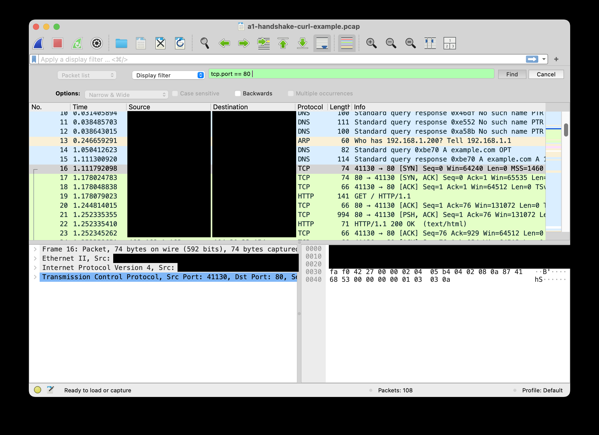
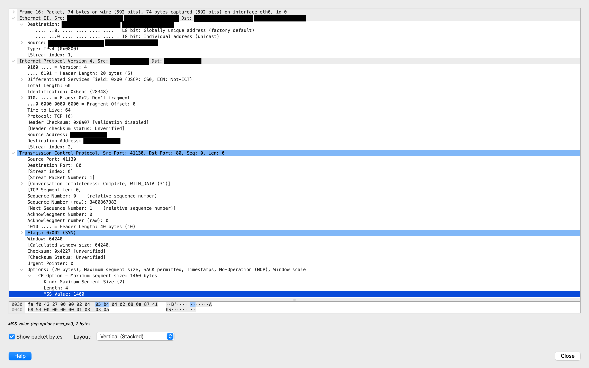
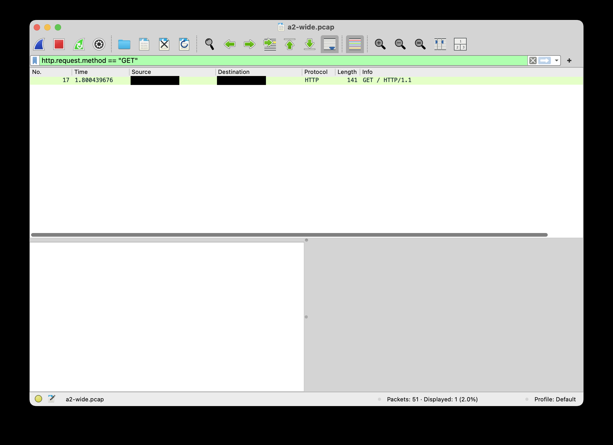
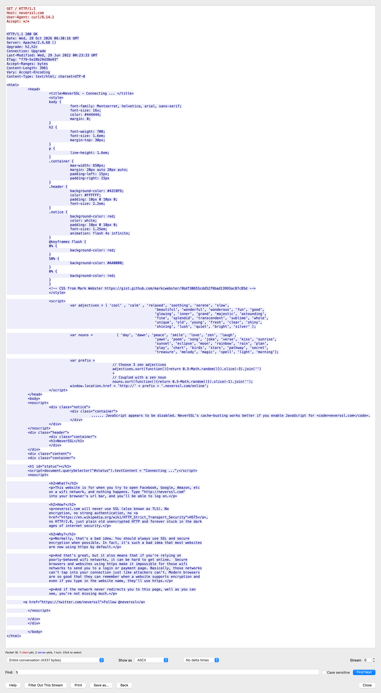
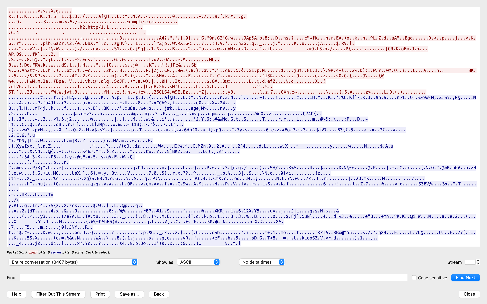
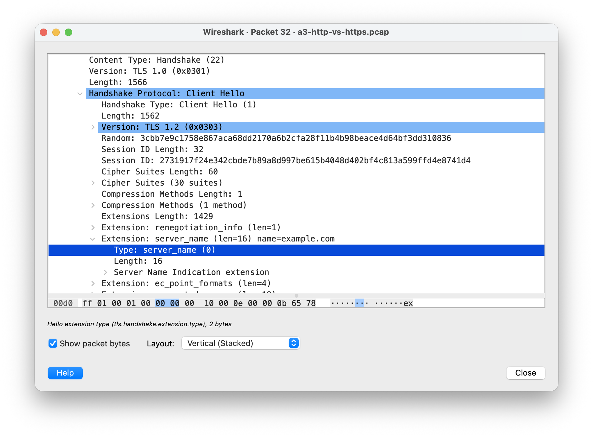

I knew the difference between TCP and UDP and what a port is, but I had never actually watched any of it on the wire — and I couldn't have told you which address in a packet is local to my network and which one travels end to end. A lot of what I want to build next — an IDS that flags port scans, OT protocol work, passive network discovery — quietly assumes I can open a capture and *read* it. So instead of trusting my vocabulary, I wanted to see what my own traffic actually looks like: one handshake, one DNS lookup, one ARP exchange, one port scan, taken apart layer by layer.

What I didn't expect is how often the capture disagreed with me — and, more interestingly, how often it disagreed with the tools. Wireshark's Source column, a TLS version field, `ufw status`, and the firewall's own log each told me something that a single field further down the packet contradicted.

## Summary

**The problem.** I knew the words but had never verified the model. I couldn't have told you which address in a packet changes at each hop, or what a SYN scan looks like when the target's firewall drops packets instead of rejecting them.

**The setup.** A Raspberry Pi captures with `tcpdump`/`tshark` on the CLI; the `.pcap` files go to my Mac, where I read them in Wireshark. Everything captured is my own hosts' traffic on my own network.

```
 capture (Pi, CLI)              transfer             analysis (Mac, GUI)
 tcpdump / tshark  ──►  .pcap  ──►  rsync  ──►  Wireshark + tshark -r
 eth0 / br-… (Docker)                            display filters, Follow Stream
```

**What I did and verified:**
- A TCP three-way handshake dissected from Ethernet up to TCP options
- Capture filters vs display filters, compared on the same traffic by packet count
- DNS, ARP, HTTP and TLS 1.3 captured and read field by field
- An `nmap -sS` scan against two targets on the same Pi, read packet by packet and compared with the firewall log

**Result:** At least five predictions I wrote down before capturing were refuted by the capture. Four times, a status or a field said one thing and the packet showed another. My host firewall dropped every probe of a SYN scan — and logged none of the ones I captured.

**Skills demonstrated:** packet capture on Linux without root (`dumpcap` capabilities), BPF vs Wireshark display filter syntax, L2/L3/L4 analysis, DNS/ARP/HTTP/TLS dissection, NAT and TTL reasoning, port-scan signature analysis, firewall log verification.

---

## Overview / Purpose

This is a hands-on foundation project, not a build. The goal was to make the "read the packet" skill real: capture my own traffic, dissect the protocols I use every day, learn where capture filters and display filters differ, follow a stream end to end, and recognize a port scan in raw packets. I wrote down a prediction before every capture so the capture could prove me right or wrong.

| Tool | Category |
|---|---|
| `tcpdump` | Capture on the Pi (BPF capture filters) |
| `tshark` | Wireshark's CLI — same dissectors, used for capture and for scripted reading (`-r`, `-Y`, `-T fields`) |
| Wireshark | GUI analysis on the Mac: display filters, packet details, Follow TCP Stream |
| `capinfos` | Packet counts and file sizes to compare captures |
| `dig`, `curl`, `ping` | Generating DNS, HTTP/HTTPS and ICMP traffic on demand |
| `nmap` | SYN scan from the Mac against my own Pi |
| `ufw` / `journalctl -k` | Host firewall on the Pi, and its kernel log |
| `rsync` | Moving `.pcap` files from the Pi to the Mac |

## Architecture / Setup

*All addresses in this writeup are documentation ranges (`192.0.2.0/24` for the LAN, `198.51.100.0/24` for the Docker bridge, `203.0.113.0/24` for public hosts); the real ones are blurred in the screenshots.*

```
                         home LAN 192.0.2.0/24
  Mac 192.0.2.195 ──Wi-Fi──[ router 192.0.2.1 ]──cable── Raspberry Pi (capture point)
  Wireshark, nmap                                         │
       ▲                                                  ├─ eth0  192.0.2.162   ufw: default DROP, SSH from LAN
       │                                                  ├─ macvlan → Pi-hole   192.0.2.53  (LAN DNS, own MAC)
       └──── rsync ~/p95/captures/*.pcap ─────────────────├─ br-…   198.51.100.1 ── Pi-hole 198.51.100.3
                                                          └─ wg0   WireGuard to my VPS (no MAC)
```

| Component | What it does |
|---|---|
| Pi `eth0` | The physical interface — where every capture with a real Ethernet header happens |
| Pi-hole (Docker) | The house DNS. Reachable on the LAN through **macvlan** (its own MAC on the Pi's cable) and from the Pi itself through a Docker **bridge** |
| `ufw` | Host firewall; default `deny (incoming)`, which means DROP — no RST |
| `wg0` | WireGuard tunnel I normally SSH over — deliberately *not* used for capture |

Deliberate choices:

- **Capture on `eth0`, never `wg0` or `any`.** WireGuard is a layer-3 tunnel, and the OS says so before Wireshark does — `wg0` is the only interface without a MAC address:
  ```
  $ ip -br link
  eth0             UP             98:fe:54:xx:xx:xx <BROADCAST,MULTICAST,UP,LOWER_UP>
  br-…             UP             c6:34:d9:xx:xx:xx <BROADCAST,MULTICAST,UP,LOWER_UP>
  wg0              UNKNOWN        <POINTOPOINT,NOARP,UP,LOWER_UP>     # no MAC: no L2 to see
  ```
  `any` isn't better: it replaces the Ethernet header with Linux's "cooked capture" header.
- **Capture without root.** `tshark` captures through `dumpcap`, and Debian's `wireshark-common` can give `dumpcap` capture capabilities for members of the `wireshark` group, so the big dissector never has to run as root. I answered "No" the first time and fixed it with `sudo dpkg-reconfigure wireshark-common`; `tshark -D` running without `sudo` confirmed it.
- **Filter out my own access path.** SSH over the tunnel shows up on `eth0` as encrypted UDP to my VPS, and SSH over the LAN as TCP/22, so the default capture filter was `not port 22 and not host <VPS>`. For the port scan — which probes port 22 — I connected over the tunnel instead, so my session couldn't leak into the capture.

## What the Wire Showed — Protocol by Protocol

| Protocol | What I saw on the wire | Security takeaway |
|---|---|---|
| **Ethernet / ARP** | Request to `ff:ff:ff:ff:ff:ff` ("Who has 192.0.2.1? Tell 192.0.2.162"), unicast reply, *then* the ICMP. No authentication anywhere | Any host on the segment can answer "that IP is me" — the basis of ARP spoofing / LAN MITM |
| **Ethernet (MAC bits)** | Router MAC: LG bit 0 (factory). Pi-hole MAC `b6:…`: locally administered bit set — generated by Docker | One bit separates real NICs from virtual interfaces and randomized MACs — useful for passive inventory |
| **SSDP / IGMP (multicast)** | 15 of 30 packets in a 30-packet sample were SSDP to `239.255.255.250` — devices announcing themselves | A quiet listener gets a device inventory without sending a single packet |
| **DNS** | Query name in plain text over UDP; 63 ms on a cache miss, 0 ms from Pi-hole's cache | Every site I visit is visible to anyone on the path — even when the site itself uses HTTPS |
| **HTTP** | Follow TCP Stream shows the whole conversation: `User-Agent: curl/8.14.1`, `Server: Apache/2.4.68`, full HTML | Content *and* software versions are free reconnaissance — TLS isn't optional |
| **TLS 1.3** | Content unreadable, but the ClientHello carries `server_name=example.com` (SNI) and ALPN `h2`, `http/1.1` in clear; size and timing visible (8,407 bytes, 8 turns) | HTTPS hides *what*, not *who*. Hiding the who needs encrypted DNS (DoH/DoT) and ECH |
| **TCP SYN scan** | Same source port on every probe, window `1024`, TTL randomized 37–59, SYN-ACK answered by RST; 10 ports on 2 hosts in a run nmap timed at 1.30 s | A clear, cheap signature for an IDS — and the scanned service never sees a connection |
| **Host firewall (ufw)** | Dropped every probe to `192.0.2.162`; logged none of the 5 in my capture. Log rule: `--limit 3/min --limit-burst 10`, budget spent on the router's IGMP | A DROP policy works; its log is a sample, not a record. Scan detection needs packet visibility |

## Findings

- [x] **The three-way handshake, and the L2/L3/L4 split, seen on a single SYN**
  
  *SYN at 1.1118 s, SYN-ACK at 1.1780 s — a 66 ms round trip. The green bar here is Wireshark's Find bar, not a display filter, which is why the DNS lookup above the handshake is still visible. That mistake turned out to be useful (see Capture 3).*

  
  *One packet, three scopes: destination MAC = the router (next hop), destination IP = the server (end to end), destination port `80` (from the `http://` scheme). MSS `1460` = 1500 − 20 (IP) − 20 (TCP). Raw sequence number `3480867383`, shown as 0.*

- [x] **Capture filters decide what exists; display filters decide what's shown — confirmed by count**
  Same `curl http://example.com`, captured twice:

  | Capture | Packets | File size |
  |---|---|---|
  | Capture filter `tcp port 80` | **12** | 2,516 bytes |
  | Wide capture (only my SSH/VPS excluded) | 51 | 9,132 bytes |
  | Wide capture + display filter `tcp.port == 80` | **12** | still 9,132 bytes |

  The 39 packets missing from the first file are gone for good; in the second they're only hidden. Rule I took away: capture wide, display narrow.

  
  *`Packets: 51 · Displayed: 1 (2.0%)` — and it's frame 17, the same frame `tshark -Y` returned on the Pi. Same dissector engine, same answer from CLI and GUI.*

- [x] **The two filter languages live in different places — and `tshark` says so**
  ```
  $ tshark -i eth0 -f 'tcp.port == 80' -c 1
  tshark: Invalid capture filter "tcp.port == 80" ...
  That string looks like a valid display filter; however, it isn't a valid capture filter
  $ tshark -r a2-wide.pcap -Y 'tcp port 80'
  tshark: "port" was unexpected in this context.
    Note: That read filter code looks like a valid capture filter; maybe you mixed them up?
  ```
  BPF runs in the kernel *before* any dissection, so it only knows byte offsets and comparisons (`tcpdump -d` prints the compiled program). That's why `http.request.method == "GET"` can never be a capture filter — a third attempt, `-f 'http.request.method == "GET"'`, failed the same way. BPF could still match a GET by counting bytes, e.g. `tcp[((tcp[12]&0xf0)>>2):4] = 0x47455420` ("first four payload bytes are `GET `") — I didn't run that one, but it shows the gap: one language sees bytes, the other sees fields.

- [x] **Plain HTTP gives everything away**
  
  *4,337 bytes, all readable: method, host, `User-Agent: curl/8.14.1`, `Server: Apache/2.4.68`, and the full page.*

- [x] **TLS 1.3 hides the content — but not the destination**
  
  *The same "follow the stream" on HTTPS: 8,407 bytes of ciphertext, except two readable strings in the ClientHello — `example.com` and `h2` / `http/1.1`.*

  
  *The SNI extension, in clear before encryption starts. Also visible: `Version: TLS 1.0` and `TLS 1.2` — neither of which is the version actually used (see below).*

- [x] **The version field said TLS 1.2; the connection was TLS 1.3**
  ```
  $ tshark -r a3-http-vs-https.pcap -Y 'tls.handshake.type == 2' \
      -T fields -e tls.handshake.version -e tls.handshake.extensions.supported_version
  0x0303	0x0304          # "TLS 1.2" (frozen legacy field)   vs   TLS 1.3 (what was negotiated)
  ```
  TLS 1.3 keeps the old version fields fixed for middlebox compatibility and moves the real answer into the `supported_versions` extension. It also encrypts the server certificate, which is why no certificate name shows up in the stream above.

- [x] **ARP asks before it sends — request broadcast, reply unicast**
  After deleting the router's entry with `ip neigh flush to 192.0.2.1 dev eth0`:
  ```
  3  98:fe:54:xx → ff:ff:ff:ff:ff:ff  ARP   Who has 192.0.2.1? Tell 192.0.2.162
  4  router      → 98:fe:54:xx        ARP   192.0.2.1 is at 6c:4f:89:xx
  5  98:fe:54:xx → router             ICMP  Echo (ping) request
  ```
  *The first ping took 0.850 ms, the second 0.372 ms — the first one includes waiting for the ARP reply.*

- [x] **Three port states, three wire signatures — and two different answers from one Pi**
  ```
  $ sudo nmap -sS -n --reason -p 22,53,80,443,8080 192.0.2.162 192.0.2.53
  192.0.2.162:  22 open (syn-ack)   53,80,443,8080 filtered (no-response)
  192.0.2.53:   53,80,443 open (syn-ack)   22,8080 closed (reset)
  ```
  | nmap says | On the wire |
  |---|---|
  | `open` | SYN → SYN-ACK → **RST** from the scanner |
  | `closed` | SYN → **RST, ACK** |
  | `filtered` | SYN → nothing (nmap retried `8080` once from a new source port) |

  Same Pi, same cable — but `192.0.2.53` answered closed ports with RST while `192.0.2.162` stayed silent. Pi-hole's macvlan interface sits outside the host's `ufw`: `ufw status` says "active, deny (incoming)", and that covers one of the two addresses on the wire.

  📷 [SCREENSHOT: screenshots/closed-vs-filtered-port-rst-vs-silence.png — Wireshark, `a4-syn-scan.pcap`, Statistics → Flow Graph with "TCP Flows": SYN→SYN-ACK→RST to an open port, SYN→RST,ACK from 192.0.2.53, and unanswered SYNs to 192.0.2.162]
  *Open, closed and filtered side by side — the RST-vs-silence difference is the whole story of DROP vs REJECT.*

## 5 Captures That Taught Me More Than the Ones That Went to Plan

Before every capture I wrote down what I expected to see. These are the five where I was wrong, or where the capture contradicted the tool — kept with the correction underneath, because the wrong version is the part I'd otherwise forget.

### Capture 1 — "I'm seeing everyone's traffic"

**Symptom.** My very first 30-packet smoke test on `eth0` was full of DNS, SSDP and UDP between addresses that weren't the Pi. Only one packet involved `192.0.2.162`.

**My theory.** Pi-hole — since every device in the house uses the Pi for DNS, I assumed I was effectively seeing the whole network.

**What I checked.** Grouped the capture by destination MAC instead of destination IP:
```
$ tshark -r a0-smoke-test.pcap -T fields -e eth.dst -e ip.dst -e _ws.col.Protocol | sort | uniq -c | sort -rn
     15 01:00:5e:7f:ff:fa   239.255.255.250   SSDP     # multicast
      4 ff:ff:ff:ff:ff:ff                     ARP      # broadcast
      2 ff:ff:ff:ff:ff:ff   192.0.2.255       UDP      # broadcast
      1 b6:xx:xx:xx:xx:xx   192.0.2.53        DNS      # Pi-hole's own MAC, not the Pi's
      1 6c:4f:89:xx:xx:xx   203.0.113.53      DNS      # an upstream query, addressed to the router
      ...
```

**What it actually was.** Half right. The DNS really was there because of Pi-hole — but not because traffic was "redirected". macvlan gives Pi-hole its own MAC on the Pi's cable, so to the switch that port has two devices behind it. Everything else was broadcast or multicast, which the switch sends to every port anyway. Across the whole sample there wasn't a single unicast packet between two *other* hosts.

**The lesson:** Promiscuous mode opens the NIC's filter, not the switch's. You only see what the switch puts on your cable — seeing other hosts' unicast traffic needs a SPAN port or a TAP. And the destination MAC tells you *why* a packet reached you far faster than the destination IP does.

### Capture 2 — "The MAC comes from the IP, and DNS gives you the port"

**Symptom.** Before `curl http://example.com`, I predicted the SYN's destination MAC would be the server's, derived from its IP — probably because I'd just watched multicast MACs being derived from multicast IPs — and that DNS would tell `curl` the port.

**What the SYN showed.** Destination MAC = the router (`ip neigh`: `192.0.2.1 lladdr 6c:4f:89:…`). Destination IP = the web server. Destination port `80`, from the URL scheme, not from DNS. DNS only ever turned a name into an address.

**I made the same mistake again, one layer down.** Later I deleted the router's ARP entry and predicted the ping would start with a SYN addressed to the router's MAC. It started with an ARP request to `ff:ff:ff:ff:ff:ff` — and `ping` is ICMP, so there was never going to be a SYN. I had just deleted the MAC I expected to see; there was nothing to write in that field except "everyone".

**The lesson:** IP is end to end, MAC is the next hop, and a host learns that next-hop MAC by *asking* — derivation from the IP only happens for multicast. Once I'd watched ARP fill in the gap, the L2/L3 split stopped being a definition and became something I could predict.

### Capture 3 — The Pi's DNS query that wasn't the Pi's

**Symptom.** In the handshake capture, right before the SYN, `eth0` showed `192.0.2.162 → 203.0.113.53` asking for `example.com`. But the Pi's `/etc/resolv.conf` points at Pi-hole on the Docker bridge (`198.51.100.3`), so the Pi's own query shouldn't touch `eth0` at all.

**Hypothesis.** That packet was Pi-hole's upstream query, NATed by Docker to the Pi's address on its way out. If so, it had been routed once inside the Pi, and its TTL should be **63**, not the **64** of packets the Pi originates (the SYN right after it had 64).

**What I checked.** Frame 14's TTL: **63**. Then I captured `eth0` and the Docker bridge at the same time during a `dig`:
```
=== bridge ===                                          IP TTL
198.51.100.1  → 198.51.100.3   neverssl.com  query       64   # the Pi asks Pi-hole
198.51.100.3  → 203.0.113.53   neverssl.com  query       64   # Pi-hole asks upstream
203.0.113.53  → 198.51.100.3   neverssl.com  response   108
198.51.100.3  → 198.51.100.1   neverssl.com  response    64
=== eth0 ===
192.0.2.162   → 203.0.113.53   neverssl.com  query       63   # same packet, after NAT
203.0.113.53  → 192.0.2.162    neverssl.com  response   109   # same reply, before un-NAT
```
The same query in two places: new source address, one hop older. The reply aged one hop the other way, 109 → 108.

**A second wrong prediction in the same capture.** I expected a repeated `dig` to be answered "on the Pi". It wasn't — the Pi has no local cache and asked Pi-hole again on the bridge; Pi-hole answered from *its* cache and never went upstream. `Query time` dropped from 63 ms to 0 ms, and the record's TTL in the answer had counted down from 6 to 4 seconds — a DNS TTL, a completely different thing from the IP TTL that solved the mystery.

**The lesson:** Wireshark's Source column is a claim about who sent a packet. The TTL is evidence of how far it travelled before you saw it — and a single decrement was enough to unmask a container hiding behind NAT.

### Capture 4 — The RST that nmap didn't send

**Symptom.** In the SYN scan, the answer to every SYN-ACK was an RST from my Mac — the textbook "half-open" scan, where the handshake never completes and `sshd` never sees a connection.

**What didn't fit.** Every probe nmap sent had a different TTL (37, 39, 40, 54, 55, 58, 59…) and a window of `1024`. Every one of those RSTs had TTL **64** and window `0`.

**What it actually was.** nmap sends its SYNs from a raw socket, so the Mac's TCP stack has no idea a connection attempt exists. When a SYN-ACK arrives for a connection it never opened, the kernel rejects it. The "obvious" reading of the capture — nmap tearing the connection down — is wrong about the author: the scanner's packets carry randomized fields, the operating system's carry its defaults.

**The lesson:** Same technique as Capture 3. When a capture mixes packets from two writers, the fields one of them randomizes and the other doesn't tell you who wrote each packet. It also gave me the scan's fingerprint for free: fixed source port (`33509`, retry from `33511`), window `1024`, randomized TTL, almost no TCP options (`LEN=44` in the firewall log), and 11 SYNs for 10 ports across two hosts in a run nmap timed at 1.30 s.

### Capture 5 — My firewall blocked a scan and didn't mention it

**Symptom.** `ufw` dropped every probe to `192.0.2.162` — nmap got no response from four ports, and the capture shows 5 SYNs with no reply. Then I checked the firewall's log for the same window:
```
$ sudo journalctl -k --since "-10min" | grep 'UFW BLOCK' | grep 'SRC=192.0.2.195'
$                                                  # nothing
```
An earlier run of the same scan — which never got captured, most likely because I left a placeholder in my capture filter — had produced exactly one log line, for port 80.

**What I checked.**
```
$ sudo iptables -S | grep 'UFW BLOCK'
-A ufw-logging-deny -m limit --limit 3/min --limit-burst 10 -j LOG --log-prefix "[UFW BLOCK] "
$ sudo journalctl -k --since "-15min" | grep 'UFW BLOCK' ...   # summarized
  45 × SRC=192.0.2.1 DST=224.0.0.1 PROTO=2      # the router's IGMP queries
   1 × SRC=192.0.2.195 DST=192.0.2.162 ... PROTO=TCP DPT=80
```

**What it actually was.** `ufw`'s logging at `low` is rate-limited to 3 lines a minute (burst 10), and the router's routine IGMP membership queries are dropped and logged too. Forty-five IGMP lines in fifteen minutes is exactly 3 per minute — the log was running at its ceiling, so when the scan arrived there was no budget left for it. The DROP itself worked perfectly; it just wasn't written down.

**The lesson:** A firewall log is a sample, not a record. "No `[UFW BLOCK]` lines" didn't mean nothing was blocked — the pcap said 5, the log said 0. If I'd relied on the log to tell me whether I was being scanned, I'd have concluded I wasn't.

### What tied them all together

Every one of these came down to a field one layer lower than the thing I was looking at. The Source column hid a NAT; the TTL exposed it. The SYN's IP address told me where the packet was going; the MAC told me where it was actually being handed off. nmap's "half-open" description was right, but the TTL showed whose stack finished the job. And the firewall's status and its log both made claims the capture didn't back up. The habit I want to keep isn't any single protocol fact — it's writing the prediction down first, so a capture can actually prove me wrong.

## What This Told Me About My Own Setup

I didn't change anything during this project — the point was to observe — but the captures surfaced three things in my existing Pi setup that I'm carrying back to it:

| Observation | Why it matters | Status |
|---|---|---|
| Pi-hole's macvlan address (`192.0.2.53`) answers closed ports with RST; `ufw` never sees that traffic | `ufw status` describes the host's address, not every address on the Pi's cable. Pi-hole's exposure is decided by the container, not the firewall | Intended ports (53/80/443) are open by design; noted for the Pi-hole setup |
| The Pi's second nameserver is `192.0.2.53`, which the host can't reach (`ip neigh` → `FAILED`, a known macvlan limitation) | The DNS "fallback" exists only on paper — and both entries are the same container anyway. If Pi-hole is down, the Pi has no DNS | Noted; a real fallback (e.g. the router) would fix it |
| `ufw` log budget consumed by the router's IGMP | Real events, like a scan, never get logged | Noted; dropping IGMP without logging would free the budget, though the rate limit remains |

## What I'd Do Differently in Production

- **Put the capture point where the traffic is.** A host only sees its own traffic plus broadcast/multicast. Watching a segment properly means a SPAN port or a TAP — and, as Capture 3 showed, sometimes capturing on more than one interface (here `eth0` and the Docker bridge) to see both sides of a NAT.
- **Don't use host firewall logs for detection.** They're rate-limited by design. Scan detection belongs in an IDS reading packets — the signature in Capture 4 is exactly what I'd hand it.
- **Tune what gets logged.** Silently dropping known-noisy traffic like IGMP keeps the log budget for events that matter.
- **Treat HTTPS as content protection, not privacy.** DNS queries and the SNI leaked every destination I visited. Encrypted DNS (DoH/DoT) and ECH close those gaps where supported.
- **Anonymize captures before sharing them.** I blurred screenshots by hand for this writeup; for real work I'd rewrite addresses in the `.pcap` itself (e.g. `tcprewrite`) so files and screenshots stay consistent.
- **Write the capture plan, including placeholders, as a script.** My first scan capture never existed because I left `MAC_IP` literally in the capture filter. A script that checks its variables would have failed loudly instead.

## Reflection / What I Learned

Going in, I thought this project was about learning protocols. The protocol facts did land — I can now say which address changes at each hop and why, and what a SYN scan looks like when a firewall drops instead of rejecting. But the lesson I'll reuse is the one that ties all five captures together: a status indicator is a claim, not proof. Wireshark's Source column, the TLS version field, `ufw status`, and the firewall's own log each told me something plausible, and in every case one field further down the packet said otherwise. The tool's summary is where I start; the packet is where I check.
